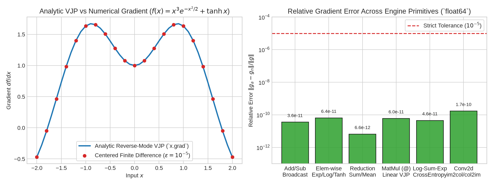
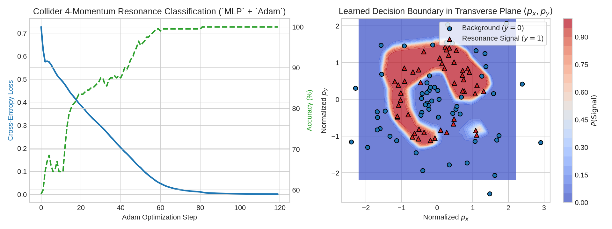
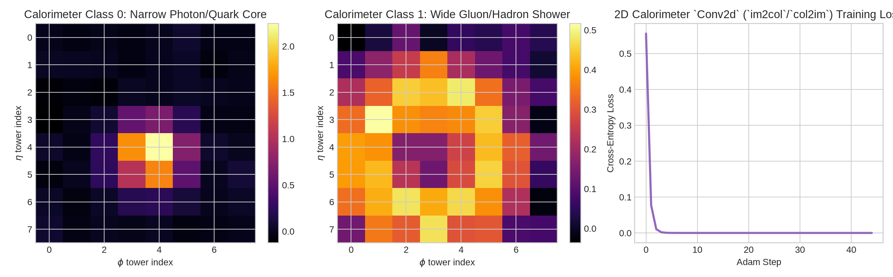

# `tensorgrad` — Pure-NumPy Reverse-Mode Tensor Autograd & Deep Learning Engine

A from-scratch, pure-`NumPy` (`float64`) implementation of **Reverse-Mode Automatic Differentiation (Backpropagation)**, **Vector-Jacobian Products (VJP)**, **Neural Network Layers (`Linear`, `MLP`, `Conv2d` via `im2col`/`col2im`)**, **Numerically Stable Log-Sum-Exp `CrossEntropy`**, and **Adaptive Optimizers (`SGD` with Momentum, `Adam`)**, benchmarked on synthetic High Energy Physics collider kinematics and 2D calorimeter shower classification.

---

## Overview & Scientific Motivation

Modern deep learning frameworks (`PyTorch`, `JAX`, `TensorFlow`) rely on dynamic or static computation graphs that propagate analytical sensitivities backward from a scalar objective function (Loss or Physical Potential Energy $L$) to every upstream tensor parameter $\theta$.

In Scientific Machine Learning (Physics-Informed Neural Networks, Hamiltonian Neural Networks, and Differentiable Detector Simulations at the CERN LHC), treating `loss.backward()` as an opaque black box is insufficient. Controlling vanishing/exploding gradients, exponential overflow in log-likelihoods, and adjoint spatial accumulation requires first-principles mastery of the underlying Vector-Jacobian Products.



---

## Mathematical Formulation & Engine Architecture

### 1. Reverse-Mode Autograd & Broadcasting VJP (`src/tensorgrad/tensor.py`)
Given an operation $Z = f(X, Y)$ and the upstream cotangent (gradient) $G = \frac{\partial L}{\partial Z}$ (`out.grad`), each node accumulates its local Vector-Jacobian Product onto its parents in reverse topological order (via Depth-First Search):

$$\text{X.grad} \mathrel{+}= \text{\_unbroadcast}\!\left(G \cdot \frac{\partial f}{\partial X},\; X.\text{shape}\right)$$

- **Multi-Path Accumulation (`+=`):** When a tensor participates along multiple branches of a directed acyclic graph (e.g., $Z = X + X$ or residual connections), gradients from all outgoing edges are summed (`+=`) by the multivariable chain rule.
- **Adjoint of NumPy Broadcasting (`_unbroadcast`):** Any axis along which an operand was replicated during the forward pass (either prepended leading dimensions or singleton dimensions of length $1$) is summed (`np.sum`) during the backward pass to restore `target_shape`.
- **Centered Finite-Difference Verification (`numerical_grad_check`):** Every analytical VJP is validated against centered finite differences with step $\epsilon = 10^{-5}$:

$$\frac{\partial L}{\partial X_i} \approx \frac{L(X + \epsilon e_i) - L(X - \epsilon e_i)}{2\epsilon}, \qquad \frac{\|g_{\text{analytic}} - g_{\text{numeric}}\|_2}{\max(\|g_{\text{analytic}}\|_2, \|g_{\text{numeric}}\|_2, 10^{-8})} < 10^{-5}$$

### 2. Matrix VJP (`@`), He Initialization & `MLP` (`src/tensorgrad/nn.py`)
For batched or 2D matrix multiplication $Z = X \mathbin{@} Y$ with $X \in \mathbb{R}^{N \times D}$, $Y \in \mathbb{R}^{D \times M}$, and upstream gradient $G \in \mathbb{R}^{N \times M}$:

$$\frac{\partial L}{\partial X} = G \, Y^T \in \mathbb{R}^{N \times D}, \qquad \frac{\partial L}{\partial Y} = X^T \, G \in \mathbb{R}^{D \times M}$$

Fully connected `Linear(in_features, out_features)` layers apply He (Kaiming) normal initialization $W \sim \mathcal{N}\!\left(0, \sigma^2 = \frac{2}{d_{\text{in}}}\right)$ to preserve activation and gradient variance across deep `ReLU` stacks.



### 3. Log-Sum-Exp `CrossEntropy` & Adaptive Optimizers (`src/tensorgrad/optim.py`)
To prevent floating-point overflow ($e^{1000} \to \infty$) when computing multi-class Softmax probabilities from raw logits $Z \in \mathbb{R}^{N \times C}$, we subtract the row-wise maximum $m_i = \max_j z_{i,j}$:

$$\text{LSE}(z_i) = m_i + \ln \sum_{j=1}^{C} e^{z_{i,j} - m_i}, \qquad L_{\text{CE}}(Z, y) = \frac{1}{N} \sum_{i=1}^{N} \left(\text{LSE}(z_i) - z_{i, y_i}\right)$$

The analytical backward VJP with respect to the logits $Z$ simplifies to:

$$\frac{\partial L_{\text{CE}}}{\partial z_{i,j}} = \frac{1}{N} \left( P_{i,j} - \mathbb{I}(j = y_i) \right) \cdot G, \qquad P_{i,j} = \frac{e^{z_{i,j} - m_i}}{\sum_k e^{z_{i,k} - m_i}}$$

Parameters are updated down the potential energy surface ($\Delta L \approx -\eta \|g\|^2 \le 0$) using either **SGD with Momentum** or bias-corrected **Adam**:

$$m_t = \beta_1 m_{t-1} + (1 - \beta_1) g_t, \qquad v_t = \beta_2 v_{t-1} + (1 - \beta_2) g_t^2$$

$$\hat{m}_t = \frac{m_t}{1 - \beta_1^t}, \qquad \hat{v}_t = \frac{v_t}{1 - \beta_2^t}, \qquad \theta_t = \theta_{t-1} - \eta \frac{\hat{m}_t}{\sqrt{\hat{v}_t} + \epsilon}$$

### 4. Vectorized 2D Convolution (`im2col` / `col2im`) (`src/tensorgrad/conv.py`)
Instead of 4 nested Python loops over batch, channel, and spatial axes, `im2col` unrolls all $(K_H \times K_W)$ sliding receptive fields of an input batch $X \in \mathbb{R}^{N \times C_{\text{in}} \times H \times W}$ into a 2D matrix $X_{\text{col}} \in \mathbb{R}^{(N \cdot H_{\text{out}} \cdot W_{\text{out}}) \times (C_{\text{in}} \cdot K_H \cdot K_W)}$:

$$H_{\text{out}} = \left\lfloor \frac{H + 2P - K_H}{S} \right\rfloor + 1, \qquad W_{\text{out}} = \left\lfloor \frac{W + 2P - K_W}{S} \right\rfloor + 1$$

Forward convolution reduces to a single BLAS matrix multiplication $X_{\text{col}} W_{\text{col}}^T + b$, while backward propagation accumulates overlapping patch gradients onto the padded image grid via `col2im` (`+=`).



---

## Repository Structure

```text
tensorgrad/
├── README.md                              # Project documentation & mathematical reference
├── requirements.txt                       # Python dependencies (numpy, scipy, matplotlib, pytest)
├── src/
│   └── tensorgrad/
│       ├── __init__.py                    # Public package exports
│       ├── tensor.py                      # Tensor autograd graph, _unbroadcast & numerical_grad_check
│       ├── nn.py                          # MatMul (@) VJP, reshape/transpose, Module, Linear, MLP
│       ├── optim.py                       # mse_loss, Log-Sum-Exp cross_entropy_loss, SGD & Adam
│       └── conv.py                        # im2col, col2im, Conv2d & In-Silico Physics Benchmarks
└── notebooks/
    ├── tensor.ipynb                       # Executed notebook for tensor.py
    ├── nn.ipynb                           # Executed notebook for nn.py
    ├── optim.ipynb                        # Executed notebook for optim.py
    ├── conv.ipynb                         # Executed notebook for conv.py
    ├── 01_autograd_gradcheck.png          # Analytic VJP vs finite-difference verification plot
    ├── 02_collider_mlp_benchmark.png      # 4D collider resonance MLP training & decision boundary
    └── 03_calorimeter_conv2d_benchmark.png# 8x8 calorimeter shower Conv2d classification plot
```

---

## Installation & Quick Start

```bash
# 1. Activate virtual environment (or create a fresh venv)
python3 -m venv venv
source venv/bin/activate
pip install -r requirements.txt

# 2. Run standalone module demonstrations & physics benchmarks
python3 src/tensorgrad/tensor.py
python3 src/tensorgrad/nn.py
python3 src/tensorgrad/optim.py
python3 src/tensorgrad/conv.py
```

### Usage Example

```python
import numpy as np
from tensorgrad import Tensor, MLP, Adam, cross_entropy_loss, numerical_grad_check

# 1. Build a 3-layer MLP (4 -> 32 -> 16 -> 2) with He initialization
rng = np.random.default_rng(42)
model = MLP(in_dim=4, hidden_dims=[32, 16], out_dim=2, activation="relu", rng=rng)
optimizer = Adam(model.parameters(), lr=0.03)

# 2. Train on synthetic 4-momentum collider events
X = Tensor(rng.normal(size=(128, 4)), requires_grad=False)
y = (np.sum(X.data[:, :3] ** 2, axis=1) > 1.2).astype(np.int64)

for step in range(50):
    optimizer.zero_grad()
    loss = cross_entropy_loss(model(X), y)
    loss.backward()
    optimizer.step()

print(f"Final Cross-Entropy Loss: {loss.data:.4f}")
```

---

## License

MIT License.
